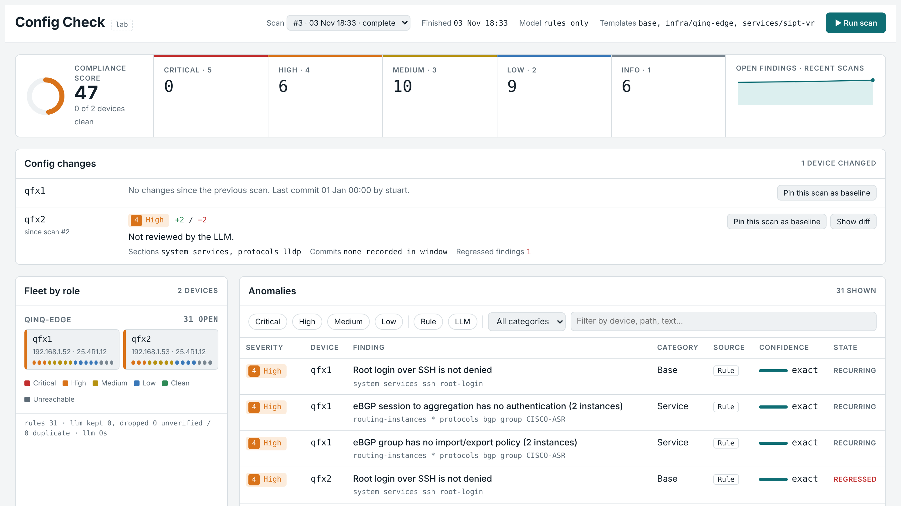

# Config Check

A NetOps dashboard that finds **configuration anomalies** and **security gaps** on
Junos devices and rates them Critical → Info. A deterministic rule engine checks
every device against your design templates. A local LLM then reviews the same
configs against your design docs and security baseline, behind a set of code
filters that stop it inventing findings.



## What it does

| Tab | Source | What you get |
|---|---|---|
| **Anomalies** | Design templates (`knowledge/templates/base\|infra\|services`), design doc, role drift, LLM review | Deviations from the design, scored per device and role |
| **Security** | Security templates (`knowledge/templates/security`), security baseline, LLM security review | Best practice vs current gap, with a suggested fix |
| **Config changes** | Commit history + snapshot diffs (every scan is a config backup) | What changed, who committed it, risk hints, baselines |

Accept-as-exception, baselines, trends and a 50-scan retention are built in.
Config Check is **read-only**: it never pushes config.

## Architecture

```
 Browser ──► backend (FastAPI + dashboard, :8080) ──► Junos MCP server (:30030, localhost) ──NETCONF──► devices
                 │  rule engine, drift, change tracking         block.cfg / block.cmd: show-only
                 │  SQLite (data/)
                 └──► Ollama (LLM + nomic-embed-text embeddings for retrieval)
```

- **Device access:** Juniper's [junos-mcp-server](https://github.com/Juniper/junos-mcp-server) over
  streamable-http with a bearer token. Devices use a `cc-ro` login class, so there are three read-only layers.
- **Rule engine** (`app/rules.py`): `.set` templates with `@id/@sev/@title/@doc/@scope/@builtin/@practice`,
  `{{placeholders}}` from the inventory, built-ins `fabric_peers`, `vni_mapping` and `bgp_auth`.
  Syntax: [knowledge/README.md](knowledge/README.md).
- **LLM** (`app/llm.py`): retrieval over design docs and templates, then a JSON-schema answer. The output passes
  filters before anything reaches the dashboard:
  - evidence must quote real config lines;
  - the design quote must exist in the docs;
  - fixes must not be no-ops;
  - the reasoning must not argue itself out of the finding;
  - fixes must not just repeat what the rules already report;
  - placeholders must be handled correctly;
  - templates outrank the LLM.
- **Model:** `deepseek-r1:14b` gave the best results on an RTX 3060 12 GB (compared with `qwen3.5:9b` and `gpt-oss:20b`).
  gpt-oss returns empty answers here because it can't disable thinking.

## Repository layout

| Path | Contents |
|---|---|
| `app/` | Backend: collector, rules, LLM, changes, store, API, `static/index.html` dashboard |
| `config/inventory.yaml` | Roles, devices, per-device vars (`lo0`, `asn`). The single source of truth |
| `config/settings.yaml` | MCP URL, Ollama URL/model, scoring, retention |
| `knowledge/design/` | `HLD-evpn-fabric.md`, the design the Anomalies tab checks against |
| `knowledge/security/` | `SEC-baseline-junos.md`, the security baseline (draft; edit to your standard) |
| `knowledge/templates/` | `base/`, `infra/`, `services/`, `security/` rule templates |
| `knowledge/archive/` | Retired QinQ edge design (not loaded) |
| `mcp/policy/` | `block.cfg` (deny all config loads) and `block.cmd` (show-only) |
| `scripts/` | `deploy.sh` (full VM bootstrap), `setup.sh` (keys, token, containers), `gen_devices.py` (inventory → MCP devices.json), `check_knowledge.py` (validate edits) |
| `deploy/terraform/` | Proxmox VM + cloud-init → running Config Check in one apply |
| `lab/` | EVE-NG EVPN-VXLAN fabric configs (2 spines, 2 leaves) and the Spine_1 restore file |
| `docs/` | **[Operator guide](docs/OPERATOR-GUIDE.md)** (devices, roles, knowledge, settings, keys), device prep, hardening list, deck |

## Rebuild from scratch

**Fastest:** `deploy/terraform` creates the VM on Proxmox and installs everything with one
`terraform apply` ([guide](deploy/terraform/README.md)). On a VM you've already built (Ubuntu or AlmaLinux), run
`sudo REPO_URL=... bash scripts/deploy.sh` instead; it detects the distro. The manual steps below are what those automate.


Supported OS: **Ubuntu 22.04/24.04** or **AlmaLinux / Rocky / RHEL 9–10**. Spec: 2 vCPU, 4 GB RAM, 32 GB disk,
on a network that can reach the devices' management IPs and the Ollama host.

**1. Install Docker**

| Ubuntu | AlmaLinux / Rocky (RHEL: use `/linux/rhel/` in the repo URL) |
|---|---|
| `sudo apt update && sudo apt -y install git python3-yaml` | `sudo dnf -y install git python3-pyyaml dnf-plugins-core` |
| `curl -fsSL https://get.docker.com \| sudo sh` | `sudo dnf -y remove podman-docker podman buildah runc` *(they conflict with Docker CE)* |
| | `sudo dnf config-manager --add-repo https://download.docker.com/linux/centos/docker-ce.repo` |
| | `sudo dnf -y install docker-ce docker-ce-cli containerd.io docker-buildx-plugin docker-compose-plugin` |
| `sudo systemctl enable --now docker` | `sudo systemctl enable --now docker` |
| `sudo usermod -aG docker $USER && newgrp docker` | `sudo usermod -aG docker $USER && newgrp docker` |

**2. Open the dashboard port (AlmaLinux only).** firewalld is on by default:
```bash
sudo firewall-cmd --permanent --add-port=8080/tcp && sudo firewall-cmd --reload
```
SELinux can stay **Enforcing**: every volume in `docker-compose.yml` carries a `:z` label (ignored on Ubuntu).

**3. Ollama** (GPU host): install it, then `ollama pull deepseek-r1:14b` and `ollama pull nomic-embed-text`.
Set `OLLAMA_HOST=0.0.0.0` and firewall it to the VM's IP. Put its URL in `config/settings.yaml` → `llm.base_url`.

**4. Clone and set up**
```bash
sudo mkdir -p /opt/config-check && sudo chown $USER: /opt/config-check
git clone git@github.com:stuartjackson27/config-check.git /opt/config-check   # private repo: deploy key or gh auth
cd /opt/config-check && ./scripts/setup.sh
```
`setup.sh` clones the MCP server, creates the device SSH key, generates `devices.json` and the MCP token,
and starts the stack.

**5. Devices:** apply [docs/DEVICE-PREP.md](docs/DEVICE-PREP.md) using the public key the script printed.

**6. Check it:** `docker compose ps` (both Up, junos-mcp healthy), then open `http://<vm>:8080` and press **Run scan**.

**Troubleshooting on AlmaLinux**

| Symptom | Fix |
|---|---|
| Container logs show `Permission denied` on `/opt/config-check/...` | SELinux label missing: check the `:z` on that volume, then `docker compose up -d` |
| Dashboard not reachable from your PC | `sudo firewall-cmd --list-ports` should include `8080/tcp` |
| `dnf install docker-ce` conflicts | Remove `podman-docker podman buildah runc` first (step 1) |
| Backend can't write `data/` | `sudo chown -R 1000:1000 /opt/config-check/data` |

Secrets (`secrets/`) and runtime data (`data/`) are git-ignored and must never be committed.

## Notes on this repository

This repo was published on 6 Nov 2026 after the Proxmox host failed. Code, templates, docs and the dashboard
are the exact files that were running. Two files only existed on the VM and were **reconstructed**:
`docker-compose.yml` (same services, mounts and ports, using the upstream MCP server's documented flags) and
`mcp/policy/block.cmd` / `block.cfg` (same intent: no config loads, `show` only). Check them on the first start.
The scan history (SQLite DB and config backups in `data/`) was on the VM and is not in git.

## Open items

- **LLM security pass tightening:** drop LLM findings that duplicate rule findings, block dangerous fixes
  (never disable fxp0 / SSH / NETCONF / the automation user), and drop any fix that changes a
  template-required value whatever the LLM labels it.
- **LLM timeouts:** about one 240 s timeout per scan. Raise `llm.timeout_s` to 420 or shrink chunks.
- **Overlay BFD false positive:** add path-aware retrieval so the overlay section is retrieved with the underlay.
- **Production hardening:** [docs/SECURITY-HARDENING.md](docs/SECURITY-HARDENING.md).
- **Lab stability:** nested-KVM freezes of the EVE-NG VM on Proxmox kernel 7.0.6. Pin `6.8.12-29-pve` if it recurs,
  and keep host RAM under its physical limit (EVE 22 GB; stop CasaOS while the lab runs).
